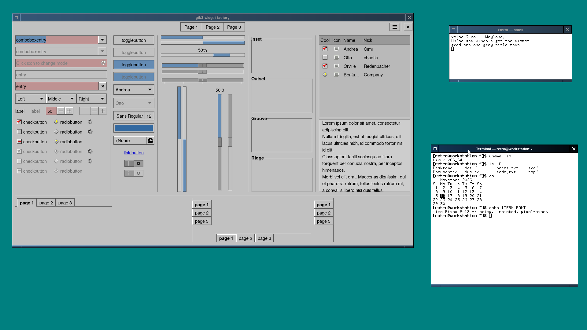
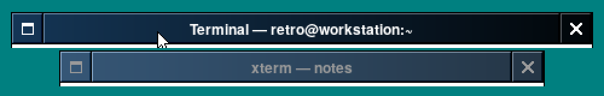

# hypr-wmdeco

**Window Maker-style titlebars and resize bars for Hyprland 0.57 (Lua config).**
It reproduces WINGs-era decorations: square minimize and close buttons, beveled
gradient titles and the bottom resize handle, all drawn by the compositor.


<p align="center"><sub>Hyprland 0.57 with hypr-wmdeco, plus
<a href="https://github.com/Gustlik501/irixium-gtk-theme">Irixium</a> (GTK),
<a href="https://github.com/Gustlik501/misc-fixed-ttf">Misc Fixed 8x13</a> (terminal) and
<a href="https://github.com/Gustlik501/chicago95-cursors">Chicago95</a> cursors.</sub></p>

<p align="center"><br>
<sub>Focused vs. unfocused, 2×: one continuous gradient across title and buttons</sub></p>

## Features

- **Window Maker 0.96 geometry and relief**: miniaturize button on the left,
  close on the right, a beveled title and a three-part resize bar along the bottom.
- **Textures**: `solid`, `hgradient`, `vgradient` and `dgradient`, set
  separately for focused, unfocused and owner (the parent of a focused dialog)
  windows. Buttons can share the title's gradient or use their own.
- **WM mouse behaviour**: drag the title to move, double-click it to maximize,
  drag the bottom corners to resize, or drag the middle of the bottom bar to
  change only the height. Resizing works for tiled windows too and goes through
  Hyprland's layout, so the window doesn't get floated.
- **Live toggling**: `hl.plugin.wmdeco.toggle()` adds or removes every bar and
  its reserved space instantly, without a restart. It fits well on a
  Modern/Retro keybind.
- **Exclusions**: by tag (default: `games`), with the `wmdeco:no_bar` window
  rule, or with `decorate = false`. Fullscreen windows never get bars.
- **Cheap to render**: one cached GPU texture per window, redrawn only when the
  title, state, size or config changes. No blur and no animations.

## Install

```nix
# flake.nix
inputs.hypr-wmdeco = {
  url = "github:Gustlik501/hypr-wmdeco";
  inputs.nixpkgs.follows = "nixpkgs";   # must match the nixpkgs your Hyprland comes from
};

nixpkgs.overlays = [ inputs.hypr-wmdeco.overlays.default ];  # pkgs.hypr-wmdeco
```

Home Manager:

```nix
wayland.windowManager.hyprland = {
  configType = "lua";
  plugins = [ "${pkgs.hypr-wmdeco}/lib/libhypr-wmdeco.so" ];
  settings.config.plugin.wmdeco.enabled = true;
};
```

Or load it yourself from your Lua config:

```lua
hl.plugin.load("/nix/store/…-hypr-wmdeco-0.1.0/lib/libhypr-wmdeco.so")
hl.config({ plugin = { wmdeco = { enabled = true, font_family = "TeX Gyre Heros" } } })
```

> [!WARNING]
> Hyprland plugins have to be built against **the exact Hyprland you run**.
> This flake builds with nixpkgs' `hyprlandPlugins.mkHyprlandPlugin`, so make
> its `nixpkgs` follow yours and rebuild both together. Matching version
> numbers alone don't guarantee a compatible ABI. The plugin refuses to load on
> a header/runtime hash mismatch. Don't combine it with hyprbars or another
> titlebar plugin.

### Recommended surroundings

The plugin only draws the bars. For the full look, also set:

```lua
hl.config({
    general = { border_size = 1, col = { active_border = "rgb(000000)", inactive_border = "rgb(000000)" } },
    decoration = { rounding = 0, blur = { enabled = false }, shadow = { enabled = false } },
})
```

Client-side decorations aren't removed, so prefer clients that support
server-side decorations, such as foot, or turn off CSD in each app.

## Toggling at runtime

Hyprland 0.57's Lua config uses `hyprctl eval`:

```sh
hyprctl eval 'hl.plugin.wmdeco.toggle()'    # or .enable() / .disable()
hyprctl eval 'hl.config({plugin={wmdeco={enabled=false}}})'   # same thing
```

Existing windows update immediately. A config reload restores whatever value
your config file sets.

## Options

All keys live under `hl.config({ plugin = { wmdeco = { … } } })` and update
live. Sizes are logical pixels. Colors take Hyprland color strings
(`"rgb(aaaaaa)"`); alpha is ignored because Window Maker textures are opaque.

| Key | Default | Meaning |
|---|---|---|
| `enabled` | `true` | Draw the bars and reserve their space |
| `font_family` | `"Helvetica"` | Any fontconfig family. `TeX Gyre Heros` is a good Helvetica stand-in |
| `font_size` | `12` | Pixel size, 1–96 |
| `font_weight` | `700` | Pango weight, 100–1000 |
| `title_height` | `0` | 0 = font ascent + descent + 8; otherwise 1–256 |
| `button_size` | `0` | 0 = title height; otherwise capped at title height |
| `button_padding` | `0` | Outer button inset, 0–64 |
| `title_padding` | `6` | Text inset in the title segment, 0–128 |
| `title_justify` | `"center"` | `left`, `center`, `right` |
| `resize_height` | `8` | Bottom bar height; 0 disables it; max 128 |
| `resize_corner_width` | `28` | Corner grip width, 0–512 |
| `double_click_ms` | `250` | Double-click interval; 0 disables |
| `exclude_tags` | `"games"` | Comma/space-separated window tags that get no bars |
| `minimize_dispatcher` | see below | Lua dispatcher run by the left button; empty disables |
| `double_click_dispatcher` | see below | Lua dispatcher run on title double-click; empty disables |

Per state, where `<state>` is `focused`, `unfocused` or `owner`:

| Key | Default |
|---|---|
| `<state>_texture` | `"solid"` |
| `<state>_color1`, `<state>_color2` | focused `#000000`, unfocused `#aaaaaa`, owner `#666666` |
| `<state>_text_color` | focused white, unfocused black, owner white |
| `<state>_button_texture` | `"inherit"` (continue the title's texture) |
| `<state>_button_color1`, `<state>_button_color2` | same as the title colors |
| `resize_texture` / `resize_color1`, `resize_color2` | `"solid"` / `#aaaaaa` |

Dispatcher defaults:

```lua
minimize_dispatcher     = 'hl.dsp.window.move({ workspace = "special:minimized", follow = false })'
double_click_dispatcher = 'hl.dsp.window.fullscreen({ mode = "maximized", action = "toggle" })'
```

To get minimized windows back, bind `hl.dsp.workspace.toggle_special("minimized")`.

### Example: the screenshot's colors and a purple theme

```lua
-- Navy gradient, as in the screenshot
hl.config({ plugin = { wmdeco = {
    font_family = "TeX Gyre Heros",
    focused_texture = "hgradient",   focused_color1 = "rgb(153656)",   focused_color2 = "rgb(020609)",
    unfocused_texture = "hgradient", unfocused_color1 = "rgb(365777)", unfocused_color2 = "rgb(253646)",
    unfocused_text_color = "rgb(999999)",
    resize_texture = "hgradient",    resize_color1 = "rgb(365777)",    resize_color2 = "rgb(253646)",
} } })

-- Purple
hl.config({ plugin = { wmdeco = {
    focused_texture = "hgradient",   focused_color1 = "rgb(9f79ee)",   focused_color2 = "rgb(433364)",
    unfocused_texture = "hgradient", unfocused_color1 = "rgb(33263f)", unfocused_color2 = "rgb(110c18)",
    unfocused_text_color = "rgb(ffffff)",
} } })

-- No bar for one app
hl.window_rule({ match = { class = "^example-game$" }, ["wmdeco:no_bar"] = true })
```

## Debugging

`hl.plugin.wmdeco.stats()` returns the paint and render counters. Use `repl`
to see return values, since `eval` only acknowledges:

```sh
hyprctl repl 'local s=hl.plugin.wmdeco.stats(); return s.paint_count,s.render_count,s.title_height,s.enabled'
```

[TESTING.md](TESTING.md) describes how the plugin is tested. Everything runs in
a private, offscreen Hyprland driven by a guarded virtual pointer, never in a
live session. That covers moves, resizes, buttons, maximize, toggles, plugin
reloads and texture-cache behaviour. Not covered yet: fractional scaling,
Xwayland, complex popups and touch input.

## Credits and license

**GPL-2.0-or-later.** Based on [hyprbars](https://github.com/hyprwm/hyprland-plugins)
v0.57.0 (BSD-3-Clause, Hypr Development / Vaxry) and Window Maker 0.96.0's
defaults, masks and relief algorithms (GPL-2.0-or-later; wraster originally
LGPL-2.0-or-later). See [SOURCES.md](SOURCES.md) for what came from where and
what differs. All license texts are included.

---

Part of a small retro-desktop set for Hyprland:
**hypr-wmdeco** ·
[irixium-gtk-theme](https://github.com/Gustlik501/irixium-gtk-theme) ·
[chicago95-cursors](https://github.com/Gustlik501/chicago95-cursors) ·
[misc-fixed-ttf](https://github.com/Gustlik501/misc-fixed-ttf) ·
[nextlike-icons](https://github.com/Gustlik501/nextlike-icons)
